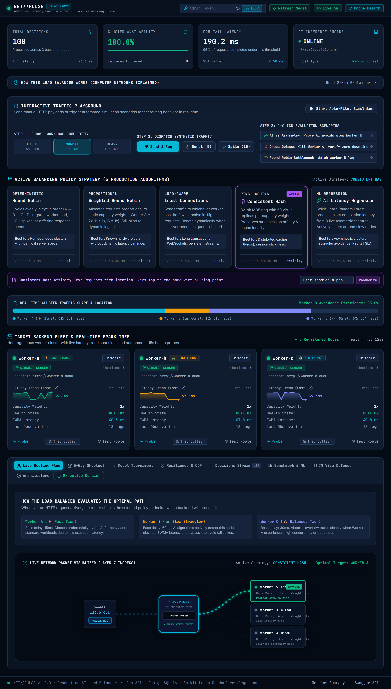
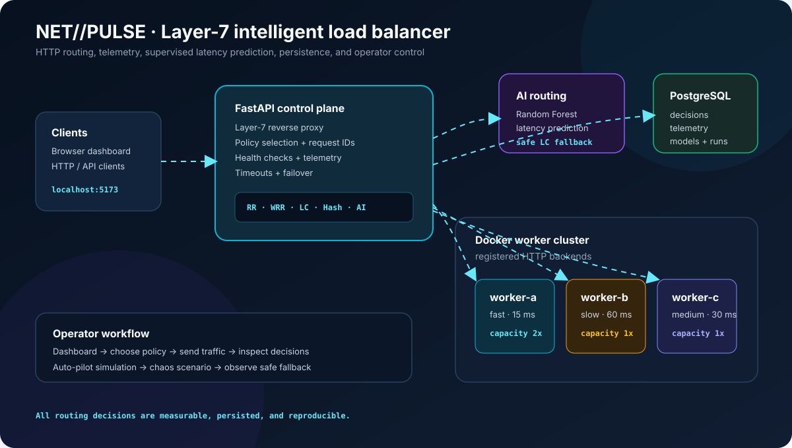
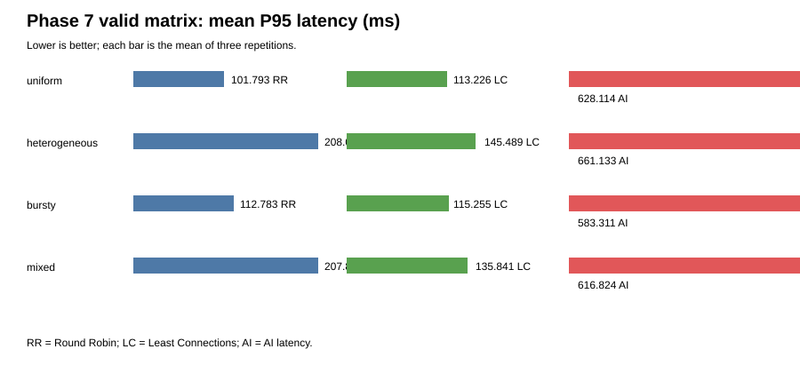

<div align="center">

# NET//PULSE

### AI-assisted Layer-7 load balancing for heterogeneous HTTP services

[](docs/FINAL_RELEASE_NOTES.md)
[](backend/tests/)
[](https://www.python.org/)
[](https://fastapi.tiangolo.com/)
[](https://react.dev/)
[](https://www.postgresql.org/)
[](https://docs.docker.com/compose/)

**A full-stack Computer Networks project that makes HTTP routing visible, measurable, and explainable.**

[Quick start](#quick-start) · [How it works](#how-it-works) · [Live demo](#demonstrate-the-system) · [Research](#research-evidence) · [Documentation](#documentation)

</div>

> **Status:** Verified academic release candidate. This is a tested software prototype, not production-certified infrastructure. The benchmark evidence is preserved and the project does not claim that AI routing is always faster.

## What is NET//PULSE?

NET//PULSE is an observable Layer-7 HTTP reverse proxy and load-balancing control plane. It receives a request, evaluates the registered backend workers, chooses a routing strategy, forwards the request, measures the result, and stores the complete decision in PostgreSQL.

The project compares conventional scheduling with supervised machine-learning routing:

- **Round Robin**: deterministic cyclic distribution.
- **Weighted Round Robin**: proportional distribution using backend capacity weights.
- **Least Connections**: selects the worker with the lowest in-flight load.
- **Consistent Hashing**: preserves request-key affinity for cache/session-style traffic.
- **AI Latency Regressor**: predicts expected latency from backend telemetry.

The dashboard adds a visual control room around the system: live traffic playground, auto-pilot traffic simulation, policy cards, packet-flow animation, worker sparklines, chaos/failover scenarios, model status, benchmark views, and plain-English Computer Networks explainers.

## Website preview

The dashboard is a dark cyber-operations interface designed to make the routing path understandable during a live demonstration.



> The screenshot was captured from the running Docker Compose dashboard. Start the stack locally to interact with the live controls.

## Architecture



### Request lifecycle

```text
HTTP request
    ↓
FastAPI Layer-7 proxy
    ↓
Check enabled + healthy + fresh workers
    ↓
Apply selected routing policy
    ↓
Forward to worker-a, worker-b, or worker-c
    ↓
Measure latency, status, and fallback reason
    ↓
Persist decision and telemetry in PostgreSQL
    ↓
Return response with correlation ID
```

### Services

| Service | Responsibility | Local address |
|---|---|---|
| `api` | FastAPI proxy, routing engine, health checks, model and experiment APIs | `http://localhost:8000` |
| `frontend` | React/TypeScript dashboard served through Nginx | `http://localhost:5173` |
| `worker-a` | Fast simulated backend | Docker network only |
| `worker-b` | Slow simulated backend | Docker network only |
| `worker-c` | Medium simulated backend | Docker network only |
| `db` | PostgreSQL persistence and migrations | Docker network only |

Default worker behavior is intentionally heterogeneous: worker A is fast (15 ms base delay), worker B is slow (60 ms), and worker C is medium (30 ms). This makes policy differences visible without requiring external infrastructure.

## Quick start

### Requirements

- Docker Desktop with Docker Compose v2
- PowerShell on Windows or an equivalent shell
- At least 4 GB of available Docker memory

### Configure secrets locally

```powershell
cd "C:\Users\krish\OneDrive\Desktop\CN Project\ai_load_balancer_starter"
Copy-Item .env.example .env -ErrorAction SilentlyContinue
```

Edit `.env` and set local values:

```env
ADMIN_TOKEN=replace-with-a-local-operator-token
POSTGRES_PASSWORD=replace-with-a-local-database-password
```

Never commit or share `.env`.

### Start the complete application

```powershell
docker compose --env-file .env -f deployment\docker-compose.yml up --build -d
docker compose --env-file .env -f deployment\docker-compose.yml ps
```

Open the application:

- Dashboard: <http://localhost:5173>
- FastAPI: <http://localhost:8000>
- Swagger API: <http://localhost:8000/docs>

Verify liveness and database readiness:

```powershell
Invoke-RestMethod http://localhost:8000/health/live
Invoke-RestMethod http://localhost:8000/health/ready
```

Expected:

```json
{"status":"alive"}
{"status":"ready"}
```

The dashboard asks for the configured operator token when an administrative action is required. The current frontend keeps that token in browser memory only.

### Stop safely

```powershell
docker compose --env-file .env -f deployment\docker-compose.yml stop
```

To remove containers while preserving PostgreSQL records:

```powershell
docker compose --env-file .env -f deployment\docker-compose.yml down
```

Avoid `docker compose down -v` unless you intentionally want to delete the local database volume.

## How it works

### 1. Backend eligibility

Before routing, the API considers only registered workers that are:

- Enabled
- Healthy or recently verified
- Reporting fresh telemetry
- Reachable within the configured timeout

Disabled, failed, stale, or malformed workers are excluded from the candidate pool.

### 2. Policy selection

The active policy is persisted in PostgreSQL. The dashboard can switch the policy, and every request records which policy was used.

### 3. Forwarding and measurement

The API forwards the HTTP request to the selected worker using HTTPX. It records:

- Request ID
- Policy
- Selected worker
- Predicted latency
- Actual latency
- HTTP status code
- Success or failure
- Fallback reason
- Feature vector and timestamp

### 4. Safe AI behavior

The AI policy uses a validated Random Forest artifact. Its feature schema includes CPU, memory, active requests, EWMA latency, network RTT, error rate, capacity weight, and request class.

AI routing falls back to Least Connections when:

- The model is missing.
- The artifact is corrupt or incompatible.
- Inference raises an error.
- The output is NaN, infinite, negative, or outside safe bounds.
- Candidate telemetry is stale or invalid.

This makes model failure a visible routing state instead of a service outage.

## Demonstrate the system

### Prepare operator authentication

```powershell
$env:ADMIN_TOKEN="your-local-admin-token"
$h=@{"X-Admin-Token"=$env:ADMIN_TOKEN}
```

### Probe all workers

```powershell
Invoke-RestMethod `
  http://localhost:8000/api/v1/backends/health-check-all `
  -Method Post -Headers $h
```

### Compare policies from the API

Select Round Robin:

```powershell
Invoke-RestMethod http://localhost:8000/api/v1/policies `
  -Method Post -Headers $h -ContentType application/json `
  -Body '{"policy":"round_robin"}'
```

Send six requests:

```powershell
1..6 | ForEach-Object {
  Invoke-RestMethod `
    "http://localhost:8000/api/v1/route?request_class=normal" |
    Select-Object backend,policy,actual_latency_ms,fallback_reason
}
```

Repeat with:

```json
{"policy":"weighted_round_robin"}
{"policy":"least_connections"}
{"policy":"ai_latency"}
```

For AI routing, inspect `predicted_latency_ms`, `ai_inference_latency_ms`, and `fallback_reason`. If no valid model has been provisioned, `MODEL_UNAVAILABLE` fallback is expected.

### Use the dashboard demonstration flow

1. Open `http://localhost:5173`.
2. Enter the local admin token.
3. Check the three worker health cards.
4. Choose a policy card.
5. Use **Send 1 Req**, **Burst**, or **Spike** in the traffic playground.
6. Start **Auto-Pilot** to generate continuous demo traffic.
7. Run the AI-versus-asymmetry scenario to show why worker speed matters.
8. Run the chaos/failover scenario to show worker exclusion and recovery.
9. Open the live packet visualizer to follow a request from client to selected worker.
10. Inspect decisions, telemetry, shootout, model, resilience, and benchmark tabs.

### Simulate a worker outage

```powershell
$nodes=Invoke-RestMethod http://localhost:8000/api/v1/backends
$workerB=$nodes | Where-Object name -eq "worker-b"

Invoke-RestMethod `
  "http://localhost:8000/api/v1/backends/$($workerB.id)" `
  -Method Patch -Headers $h -ContentType application/json `
  -Body '{"enabled":false}'
```

Route requests again. Worker B should no longer be selected. Restore it with:

```powershell
Invoke-RestMethod `
  "http://localhost:8000/api/v1/backends/$($workerB.id)" `
  -Method Patch -Headers $h -ContentType application/json `
  -Body '{"enabled":true}'

Invoke-RestMethod `
  http://localhost:8000/api/v1/backends/health-check-all `
  -Method Post -Headers $h
```

## API reference

Open the generated Swagger UI at <http://localhost:8000/docs>.

| Endpoint | Purpose | Auth |
|---|---|:---:|
| `GET /health/live` | Process liveness | No |
| `GET /health/ready` | Database readiness | No |
| `GET /api/v1/system/status` | Active policy and model status | No |
| `GET /api/v1/route` | Route one HTTP request | No |
| `GET /api/v1/backends` | List registered workers | No |
| `PATCH /api/v1/backends/{id}` | Enable, disable, or update a worker | Admin |
| `POST /api/v1/backends/health-check-all` | Probe workers | Admin |
| `POST /api/v1/policies` | Change active policy | Admin |
| `GET /api/v1/decisions` | Read routing history | No |
| `GET /api/v1/metrics/summary` | Aggregate latency and success metrics | No |
| `GET /api/v1/metrics/timeseries` | Time-bucketed metrics | No |
| `GET /api/v1/models/status` | Model readiness | No |
| `POST /api/v1/models/train` | Train a model from observations | Admin |
| `POST /api/v1/experiments` | Create a controlled experiment | Admin |

Administrative requests use:

```http
X-Admin-Token: your-local-admin-token
```

## Persistence and metrics

PostgreSQL stores:

- `backend_nodes`: registered worker configuration and status
- `telemetry_samples`: health and performance observations
- `routing_decisions`: auditable request-level routing history
- `model_versions`: model artifacts and validation metadata
- `experiment_runs`: workload and policy configurations
- `experiment_metrics`: aggregated experiment results

Useful requests:

```powershell
Invoke-RestMethod "http://localhost:8000/api/v1/metrics/summary?window=5m"
Invoke-RestMethod "http://localhost:8000/api/v1/metrics/timeseries?metric=p95_latency&window=15m&step=10s"
Invoke-RestMethod "http://localhost:8000/api/v1/decisions?limit=20"
```

## Research evidence

The repository includes a preserved 36-run evaluation across uniform, heterogeneous, bursty, and mixed-cost workloads. The academically defensible conclusion is:

- Round Robin is simple and predictable.
- Least Connections is a strong general-purpose baseline.
- AI routing can use telemetry to adapt to asymmetry.
- Model inference adds overhead.
- AI was not universally faster in the measured workload.

The evidence and methodology are available here:

- [`docs/phase-7-benchmark-results.md`](docs/phase-7-benchmark-results.md)
- [`docs/phase-7-experiment-methodology.md`](docs/phase-7-experiment-methodology.md)
- [`docs/phase-8-analysis.md`](docs/phase-8-analysis.md)
- [`docs/phase-8-failure-mode-results.md`](docs/phase-8-failure-mode-results.md)
- [`docs/charts/phase7-results.svg`](docs/charts/phase7-results.svg)



## Testing and validation

Run backend tests:

```powershell
cd backend
python -m pytest -q
```

Build the frontend:

```powershell
cd frontend
npm ci --ignore-scripts
npm run build
```

Validate Compose:

```powershell
docker compose --env-file .env -f deployment\docker-compose.yml config --quiet
```

The verified release also includes PostgreSQL migration checks, API restart persistence, clean Compose installation validation, Docker image builds, and Playwright dashboard smoke coverage.

## Repository map

```text
backend/       FastAPI app, routing, ML, persistence, experiments
db/            SQLAlchemy models and Alembic migrations
deployment/    Docker Compose and service configuration
frontend/      React, TypeScript, Vite, Tailwind, Nginx dashboard
workers/       Simulated HTTP backend services
load_testing/  Locust workloads and experiment helpers
ml/            Model artifacts and training files
docs/          Architecture, API, audit, benchmark, and academic material
```

## Documentation

- [Complete technical documentation](docs/PROJECT_DOCUMENTATION.md)
- [Demo runbook](docs/DEMO_RUNBOOK.md)
- [API contract](docs/05-api-contract.md)
- [ML methodology](docs/06-ml-methodology.md)
- [Testing and evaluation](docs/07-test-and-evaluation.md)
- [Security and risk](docs/08-security-and-risk.md)
- [Final release checklist](docs/FINAL_RELEASE_CHECKLIST.md)
- [Full project audit](docs/final-audit/FINAL_PROJECT_AUDIT_REPORT.md)
- [Academic submission checklist](docs/ACADEMIC_SUBMISSION_CHECKLIST.md)
- [Viva questions and answers](docs/VIVA_QUESTIONS_AND_ANSWERS.md)

## Known limitations

This is intended for controlled local and academic use. Before an untrusted public deployment, address:

- Authentication for experiment list/detail/status/export reads
- Allowlisting experiment target URLs
- Rate limiting and resource quotas
- Scheduled health checks and circuit breakers
- Graceful shutdown of in-flight requests
- Model freshness and clean model provisioning
- Multi-process routing-policy coordination

## License

This project is released under the [MIT License](LICENSE).
