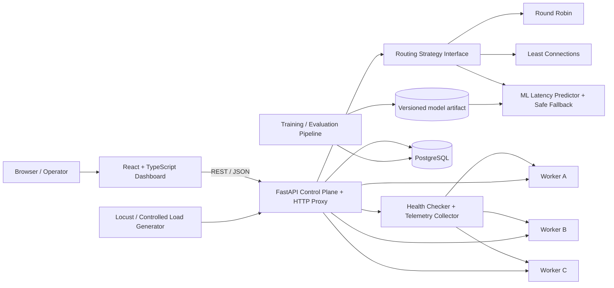

# 3. System Architecture

## 3.1 Architectural overview

## 3.2 Component responsibilities

### Frontend
A responsive React/TypeScript dashboard. Recommended views: Overview, Backends, Live Decisions, Experiments, Model & Data, Settings. Use typed API clients, reusable chart components, and explicit loading/error/empty states. Display UTC timestamps in a readable local format.

### API and proxy
FastAPI exposes REST endpoints, validates input with Pydantic, authenticates mutating/admin routes, applies request timeouts, and forwards only to worker URLs registered by an operator. The proxy should not accept an arbitrary upstream URL supplied by a user.

### Routing engine
Implement a common strategy interface, for example `select_backend(request_context, candidates) -> RoutingDecision`. Strategies must be independently unit-tested. The result should include the worker, policy name, optional prediction, model version, and any fallback reason.

### Health and telemetry
Poll worker health/metrics on a configurable interval. Track health status, CPU/memory where available, active requests, recent response-time EWMA, network/probe latency, error rate, and capacity weight. Mark samples stale after a defined threshold. Health and telemetry are separate: a worker can be healthy but heavily loaded.

### Backend workers
Three configurable instances of the same application, each with its own worker ID, capacity weight, simulated base delay, and optional injected failure/load profile. Each exposes `/health` and `/metrics` plus a deterministic demo workload endpoint. Keep worker profiles visible in the experiment configuration so synthetic conditions are not confused with real-world findings.

### ML pipeline
Use a supervised regression model to estimate response latency for a candidate worker. Persist model metadata and evaluation metrics in the database; store the model artifact outside source control (or use a small sample artifact only if explicitly documented). Make model version, training data range, and evaluation results visible.

### Database
PostgreSQL stores worker configuration, telemetry samples, routing decisions, experiment runs, aggregate metrics, model versions, and optional audit entries. Use Alembic migrations. Avoid storing request/response bodies.

## 3.3 Request flow
1. Browser sends a demo request to the proxy endpoint.
2. The API loads enabled workers and filters those whose health is not healthy or whose telemetry is too stale.
3. The selected routing strategy chooses a worker. AI mode creates one feature vector per candidate and scores it with the current model.
4. If no model is loaded, predictions are invalid, or inference raises an error, the strategy uses the configured safe fallback and records why.
5. The proxy forwards the request with a strict timeout and a bounded set of headers.
6. The API records status, elapsed time, selected backend, model version, prediction, and fallback information.
7. The dashboard refreshes metrics through polling or server-sent events if implemented later.

## 3.4 AI routing decision
For every healthy candidate backend `i`, build features from **pre-routing** telemetry:

`x_i = [cpu_pct, memory_pct, active_requests, latency_ewma_ms, network_rtt_ms, error_rate, capacity_weight, request_class]`

The model estimates `latency_hat_i = f(x_i)`. Exclude unhealthy nodes before scoring. Apply bounded safety penalties for stale telemetry or near-capacity conditions, then select the candidate with the lowest valid predicted cost. Document the cost function and tune it only through recorded experiments; do not silently change parameters between comparisons.

## 3.5 Deployment topology
For local development, use Docker Compose with services for `frontend`, `api`, `db`, `worker-a`, `worker-b`, and `worker-c`. Use a persistent volume for PostgreSQL. The frontend should call the API through a single configured base URL. Keep secrets in environment variables, not in source files.

## 3.6 Optional SDN extension
If the academic evaluator requires packet-level network topology, add a separate experiment using Mininet and an OpenFlow controller. Keep this extension isolated from the main HTTP application and label its results separately. Mininet creates virtual hosts, switches, and links on one machine, and its walkthrough is a useful starting point: https://mininet.org/walkthrough/.
