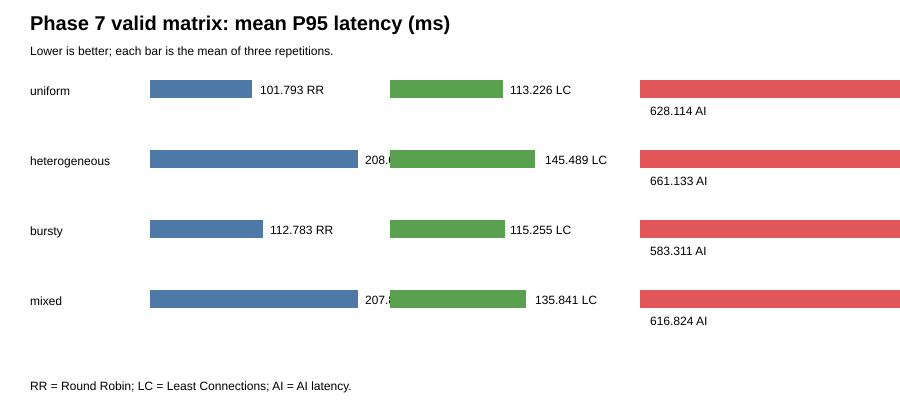

# AI-Based Load Balancing in Computer Networks

## Title page

**Institution:** [Institution name]  
**Department:** [Department name]  
**Project title:** AI-Based Layer-7 HTTP Load Balancing in Computer Networks  
**Student/team:** [Student or team name]  
**Faculty guide:** [Supervisor name]  
**Academic year:** [Academic year]

## Abstract

This project implements and evaluates a Layer-7 HTTP load balancer that
compares Round Robin, Least Connections, and a supervised machine-learning
policy. The system uses FastAPI, HTTPX, PostgreSQL, Docker Compose, three
configurable worker services, and a React dashboard. The AI policy uses a
Random Forest regressor trained from persisted routing telemetry to predict
backend latency, while health filtering and Least Connections fallback
protect availability.

A controlled 36-run matrix evaluated three repetitions of each policy across
uniform, heterogeneous, bursty, and mixed workloads. All valid runs completed
with zero request errors. In this environment, AI latency routing was slower
and had lower throughput than both conventional policies in every profile.
Its measured inference p50 was approximately 52.041 ms and its routing
concentrated successful requests on worker-a. Separate reliability tests
confirmed backend exclusion, HTTP 503 and timeout mapping, missing-model
fallback, stale-telemetry rejection, and recovery. The contribution is
therefore a reproducible, auditable testbed and empirical comparison, not a
claim that AI routing universally improves load balancing.

## 1. Introduction

Modern services distribute HTTP requests among multiple workers to improve
availability, latency, and resource utilization. Conventional policies are
simple and inexpensive, while adaptive policies can use telemetry to react to
changing service conditions. The engineering question is whether prediction
quality is sufficient to justify the extra computation and state management.

### Problem statement

A load balancer must route only to usable workers, preserve request
correlation, tolerate worker failures, and make policy choices measurable.
An ML policy must be evaluated against strong conventional baselines under
the same conditions rather than being judged by an isolated demo.

### Objectives and scope

The project objectives were to implement a registered-backend-only HTTP proxy,
Round Robin and Least Connections baselines, supervised latency prediction,
health-aware fallback, PostgreSQL persistence, a dashboard, and a reproducible
benchmark harness. The scope is a local Layer-7 testbed with simulated worker
delays. Layer-3/Layer-4 routing, SDN control, Internet-scale deployment, and
production capacity claims are outside scope.

## 2. Literature review

The project treats conventional algorithms as required baselines. NGINX
documentation describes Round Robin and least-connected approaches and
provides a practical reference for baseline terminology. Survey material in
`docs/12-research-and-sources.md` frames load balancing as a trade-off among
throughput, tail latency, utilization, fairness, and availability. Research
on reinforcement learning highlights state, reward, safe exploration, and
simulation-transfer concerns; this project uses supervised regression instead
to keep the experiment auditable and bounded.

The project gap is deliberately modest: a student-scale reproducible testbed
that records telemetry, model versions, raw request observations, fallback
reasons, and policy comparisons across heterogeneous workloads and failures.

## 3. Requirements and system design

The API accepts only registered backend nodes. Health checks combine worker
health and metrics endpoints; stale telemetry excludes a node. Routing
decisions persist request ID, selected backend, policy, model version,
features, prediction, actual latency, status, and failure information.

The deployment consists of a FastAPI control plane, PostgreSQL, worker-a,
worker-b, worker-c, and an nginx-served React frontend. Alembic migrations
create the relational schema. The dashboard reads persisted API data rather
than embedding benchmark values.

## 4. Implementation

The proxy supports:

* Round Robin for deterministic baseline distribution.
* Least Connections using current in-flight counts.
* AI latency routing using a validated Random Forest predictor.
* Least Connections fallback when the model is missing, invalid, or raises an
  inference error.
* HTTP 502 mapping for upstream errors and timeouts.
* PostgreSQL persistence for routing decisions, telemetry, models, experiments,
  raw samples, and aggregate metrics.

The worker service exposes `/health`, `/metrics`, and `/demo`, with configurable
delay and failure modes. The experiment CLI creates runs through the API,
executes warm-up and measurement windows, and exports CSV/JSON evidence.

## 5. AI model methodology

The model predicts observed upstream latency from CPU percentage, memory
percentage, active requests, latency EWMA, network RTT, error rate, capacity
weight, and request class. A fixed feature schema is stored with the
artifact. Training uses persisted successful calibration decisions and an
80/20 chronological split; evaluation outcomes from the 36-run matrix were
not used for training or tuning.

The valid matrix measured AI prediction MAE/RMSE of 165.279/198.315 ms
(uniform), 174.701/206.411 ms (heterogeneous), 124.507/161.801 ms (bursty),
and 176.897/206.991 ms (mixed). These labels compare predictions with
observed upstream latency and are separate from client-observed latency.

## 6. Experimental methodology

The normal matrix contained 3 policies × 4 profiles × 3 repetitions. Profiles
were uniform, heterogeneous (25% light, 50% normal, 25% heavy), bursty, and
mixed (20% light, 60% normal, 20% heavy). Each run used a five-second
warm-up, 30-second measurement period, concurrency four, fixed repetition
seeds, identical worker configuration, and a benchmark-safe telemetry
freshness window. Percentiles use measured client-latency samples; throughput
uses the actual measurement duration; error rate uses all measured requests.

Two prior batches remain preserved but excluded because stale telemetry caused
late 503 responses. This exclusion is documented rather than hidden.

## 7. Results and discussion

| Profile | Policy | P50 ms | P95 ms | P99 ms | Throughput/s | Error rate |
|---|---|---:|---:|---:|---:|---:|
| uniform | Round Robin | 66.349 | 101.793 | 121.655 | 57.778 | 0 |
| uniform | Least Connections | 58.216 | 113.226 | 127.259 | 61.156 | 0 |
| uniform | AI latency | 292.014 | 628.114 | 864.003 | 11.322 | 0 |
| heterogeneous | Round Robin | 66.059 | 208.071 | 230.158 | 49.589 | 0 |
| heterogeneous | Least Connections | 60.490 | 145.489 | 230.958 | 56.356 | 0 |
| heterogeneous | AI latency | 316.042 | 661.133 | 813.602 | 11.333 | 0 |
| bursty | Round Robin | 68.280 | 112.783 | 137.384 | 39.911 | 0 |
| bursty | Least Connections | 60.040 | 115.255 | 134.403 | 42.311 | 0 |
| bursty | AI latency | 328.262 | 583.311 | 712.816 | 9.611 | 0 |
| mixed | Round Robin | 66.756 | 207.806 | 231.465 | 50.000 | 0 |
| mixed | Least Connections | 61.022 | 135.841 | 229.689 | 56.844 | 0 |
| mixed | AI latency | 317.892 | 616.824 | 739.085 | 11.222 | 0 |

AI P95 was higher than both baselines in all profiles. The current evidence
supports an implementation overhead contribution: AI mean client latency was
approximately 359.527 ms versus 75.498 ms for Round Robin and 68.545 ms for
Least Connections in the valid result window, with approximately 52.041 ms AI
inference p50. Prediction error and concentration on worker-a are plausible
additional factors, but their independent causal contributions were not
isolated.



## 8. Failure-mode evaluation

Dedicated tests are reported in `phase-8-failure-mode-results.md`. Three
repetitions each covered backend disablement, direct worker 503 responses,
slow-worker timeouts, missing-model fallback, and stale telemetry. Disabled
workers were excluded; direct 503 and timeout cases became API 502 responses;
missing-model requests succeeded through fallback; stale telemetry produced
503 no-healthy-backend responses; and every injected worker was restored.

## 9. Limitations and threats to validity

The environment was a local Docker host with simulated service delays. Only
one model artifact, one concurrency level, three repetitions, and one
configuration were evaluated. The sample size is appropriate for a controlled
course project but not for universal claims or statistical significance.
Database and model-loading costs were observed in the implementation but not
independently microbenchmarked outside the request path. The earlier invalid
batches demonstrate sensitivity to telemetry freshness and are not normal
performance evidence.

Security limitations include local-token administration and a development
deployment profile. The implementation does not collect request bodies or
personal data, and secrets are excluded through `.gitignore`.

## 10. Conclusion and future work

All core implementation objectives and the approved normal-performance
evaluation were completed. The measured result is that the current AI policy
did not outperform Round Robin or Least Connections and was substantially
slower in this testbed. The system nevertheless demonstrates model
validation, safe fallback, persistence, observability, and reproducible
failure testing.

Future work should first benchmark a separately versioned optimization that
caches the validated predictor and maintains bounded in-memory telemetry
snapshots. Further work can test more concurrency levels, larger independent
calibration data, drift detection, confidence-aware fallback, and a Mininet
or SDN extension. Any such claim requires a new controlled benchmark.

## References

1. G. Liu et al., “Traffic load balancing in data center networks: A
   comprehensive survey,” *Computer Science Review*, vol. 57, 2025,
   DOI: 10.1016/j.cosrev.2025.100749.
2. D. W. D. Wu et al., “Reinforcement learning for communication load
   balancing: approaches and challenges,” *Frontiers in Computer Science*,
   2023, DOI: 10.3389/fcomp.2023.1156064.
3. NGINX, “Using nginx as HTTP load balancer,” nginx.org documentation.
4. scikit-learn, “User Guide,” scikit-learn.org documentation.
5. FastAPI, “Tutorial,” fastapi.tiangolo.com documentation.
6. Docker, “Compose documentation,” docs.docker.com.
7. Project methodology, architecture, and ML documents in `docs/`.

## Appendix A — Reproduction

```powershell
Copy-Item .env.example .env
# Set local ADMIN_TOKEN and POSTGRES_PASSWORD in .env.
docker compose --env-file .env -f deployment\docker-compose.yml up --build
$env:PYTHONPATH=(Resolve-Path .\backend).Path
python -m app.experiment_cli --matrix --duration 30 --warmup 5 --concurrency 4 --repetitions 3 --wait 2
python -m pytest -q .\backend\tests
npm --prefix .\frontend run build
```

Experiment records and exports are served by
`/api/v1/experiments` and
`/api/v1/experiments/{id}/export?format=csv|json`. The benchmark evidence and
failure procedures are documented in the Phase 7 and Phase 8 reports.

## Appendix B — Institutional placeholders

Certificate wording, declaration, signatures, formatting rules, page limits,
and contribution statements must be filled using the institution's approved
template. No names, approvals, or signatures are asserted here.
